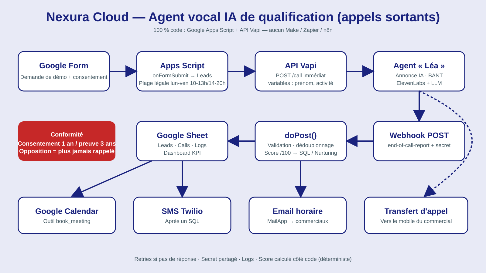

# Nexura Cloud — Agent vocal IA de qualification (appels sortants)

Un lead remplit le formulaire de démo → **Apps Script** vérifie le consentement et la plage légale → **Vapi** appelle en quelques secondes → l'agent « Léa » annonce qu'elle est une IA, qualifie en BANT → **webhook POST** vers `doPost` → score /100, statut **SQL / Nurturing**, écriture dans **Google Sheets**, SMS, RDV Calendar, email horaire. **Aucun outil no-code (Make, Zapier, n8n, IFTTT, Gumloop).**

## Structure
| Fichier | Rôle |
|---|---|
| `apps-script/Config.gs` | Constantes, colonnes, lecture des secrets |
| `apps-script/Setup.gs` | Crée les onglets + Dashboard KPI |
| `apps-script/Calls.gs` | Formulaire, file d'attente, appel Vapi, retries, conformité |
| `apps-script/Webhook.gs` | `doPost` : secret, dédoublonnage, écriture Calls |
| `apps-script/Scoring.gs` | Score /100 déterministe + routage |
| `apps-script/Integrations.gs` | Outils agent (RDV, opposition), SMS Twilio, email horaire |
| `apps-script/Utils.gs` | Logs, fenêtre légale, E.164, consentement |
| `agent/system-prompt.md`, `agent/vapi-assistant.json` | Prompt et config de l'assistant |
| `docs/payload-example.json`, `docs/form-fields.md` | Payload et formulaire |
| `tests/` | Tests scoring (node) et webhook (curl) |

## Installation pas à pas
1. **Google Sheet** : créer une feuille vide → *Extensions > Apps Script* → créer un fichier par `.gs` du dossier `apps-script/` (copier-coller).
2. Exécuter `setupSheet()` (autoriser les droits) : création des onglets `Leads`, `Calls`, `Logs`, `Dashboard`.
3. **Script Properties** (*Paramètres du projet*) : `WEBHOOK_SECRET` (chaîne aléatoire longue), `SALES_EMAIL`, `SALES_MOBILE` (+33…), puis plus tard `VAPI_API_KEY`, `VAPI_ASSISTANT_ID`, `VAPI_PHONE_NUMBER_ID`, et optionnel `TWILIO_SID/TOKEN/FROM`.
4. **Déployer** : *Déployer > Nouveau déploiement > Application Web* — Exécuter en tant que *moi*, accès *Tout le monde*. Copier l'URL `…/exec`.
5. Tester : `./tests/test-webhook.sh "<URL>" "<SECRET>"` → une ligne SQL apparaît dans `Calls`.
6. **Vapi** (vapi.ai, 5 $ offerts) : créer un numéro (ou importer Twilio), créer l'assistant à partir de `agent/vapi-assistant.json` (remplacer `__WEBAPP_URL__` et `__SECRET__`, coller le prompt, choisir une voix ElevenLabs FR). Reporter les 3 ids dans les Script Properties.
7. **Google Form** : champs de `docs/form-fields.md`, le lier à la Sheet, ajouter le trigger *À l'envoi du formulaire → onFormSubmit*.
8. Exécuter `installTriggers()` (file d'attente 5 min, email horaire, purge consentements).

## Utilisation
Soumettre le formulaire (ou ajouter une ligne dans `Leads` avec `consent_given=TRUE`) : le téléphone sonne. Suivre les résultats dans `Calls` et `Dashboard`.

## Score /100 (calculé côté code)
Autorité 30 · Budget 30 · Délai 25 · Cible 15. **≥ 70 ⇒ SQL**, sinon Nurturing. Micro-entreprise (< 5 salariés) ⇒ toujours Nurturing.

## Robustesse
Répondeur / pas de réponse → `No answer` + relance (max 3) · refus de l'IA ou opposition → statut `Opposition`, jamais rappelé · JSON invalide / payload incomplet → `try/catch` + onglet `Logs` · doublon de webhook → ignoré sur `call_id` · secret dans l'URL · hors plage légale → file d'attente jusqu'au prochain créneau · erreur API Vapi → relance 15 min.

## Conformité (démarchage téléphonique)
Lun–ven 10h–13h / 14h–20h (Europe/Paris) · consentement explicite horodaté, valable 1 an, preuve conservée 3 ans · opposition respectée immédiatement.

## Écarts avec le sujet
Le JSON du sujet n'a ni `last_name` ni score alors que le dashboard exige le nom : ajout de `contact.last_name`, `lead_id` et calcul du score dans Apps Script (non envoyé par le LLM).

## Souveraineté
Vapi (US) choisi pour sa simplicité d'API et ses webhooks natifs. Alternatives européennes à étudier : Parloa et Synthflow (Allemagne, hébergement UE). Les données sont stockées dans Google Sheets ; pour une production, privilégier un hébergement UE et un DPA signé.

## Optionnel non implémenté
Création d'un numéro par appel ; enrichissement automatique LinkedIn (le champ `Activité` du formulaire sert de source).
